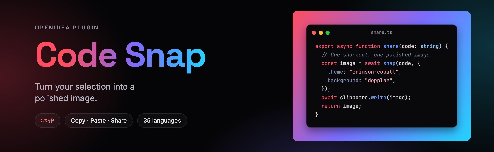
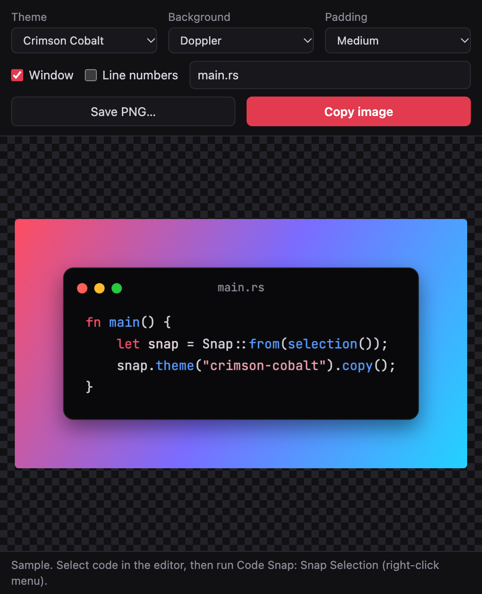
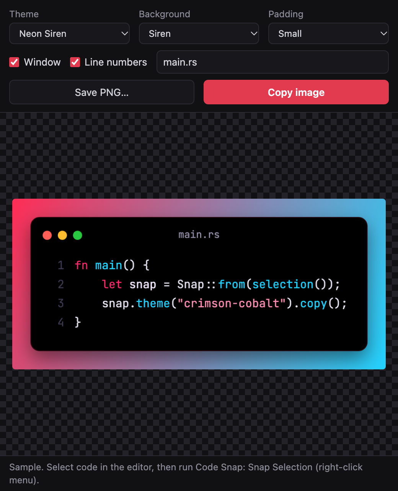

<p align="center">
  
</p>

<p align="center">
  &nbsp;
  <b>Code Snap</b> for <a href="https://github.com/l0ng-ai/openidea">OpenIDEA</a>
  &nbsp;·&nbsp; <a href="#use-it">Use it</a>
  &nbsp;·&nbsp; <a href="#styles">Styles</a>
  &nbsp;·&nbsp; <a href="#install">Install</a>
</p>

Select some code, press one shortcut, and get an image ready to paste into a
chat, a post or a README: a window frame, a gradient background and the
[Doppler](https://github.com/Rhombicdodecahedron/openidea-doppler) palettes.

<p align="center">
  
  
</p>

## Use it

1. Select some code. With nothing selected, Code Snap takes the whole file.
2. Right-click and choose **Code Snap: Snap Selection**, or press
   <kbd>⌘⌥⇧P</kbd> (<kbd>Ctrl+Alt+Shift+P</kbd> on Windows and Linux).
3. The **Code Snap** panel opens on the right. Choose a style, then press
   **Copy image** and paste it anywhere, or use **Save PNG…**.

Indentation shared by every line is removed, tabs become four spaces and blank
lines at the edges are dropped. The image is exported at 2× for sharp results
on high-density screens.

## Styles

| Option | Choices |
| --- | --- |
| Theme | **Crimson Cobalt** and **Neon Siren** (from the [Doppler](https://github.com/Rhombicdodecahedron/openidea-doppler) theme), Graphite, Paper (light) |
| Background | Doppler, Siren, Dusk, Ocean and Mint gradients, solid Graphite, or none (transparent PNG) |
| Padding | Small, Medium, Large |
| Window | macOS-style window buttons on or off |
| Line numbers | On or off |
| Title | The file name by default; edit it or clear it |

Your choices are remembered between sessions.

Syntax highlighting covers 35 languages, including Rust, TypeScript and TSX,
JavaScript, Python, Go, Java, Kotlin, Swift, C, C++, C#, PHP, Ruby, SQL, Bash,
JSON, YAML, TOML, HTML, CSS, SCSS, Markdown and GraphQL.

## Permissions

| Permission | Why |
| --- | --- |
| `editor.read` | Read the selected code, the file name and its language when you run **Snap Selection**. Nothing is read otherwise. |
| `storage` | Remember the last snippet and your style choices. |
| `clipboard` | Let the panel copy the image to the clipboard when you press **Copy image**. |

Code Snap has no network access: highlighting, fonts and rendering are all
bundled and run locally.

## Install

**From the marketplace:** open **Settings › Plugins › Marketplace**, search for
*Code Snap*, then click **Install**.

**From a release:** download the `.oiplugin` file from the
[latest release](https://github.com/Rhombicdodecahedron/openidea-code-snap/releases/latest).
In **Settings › Plugins**, open the gear menu, choose **Install Plugin from
Package File…** and pick the file.

## Build from source

You need Rust and the `openidea-plugin` tool:

```sh
cargo test                   # unit tests against the SDK's mock host
openidea-plugin build .      # builds dist/plugin.wasm and checks the package
openidea-plugin link .       # loads it in OpenIDEA (Settings › Plugins › Reload)
```

The panel is plain HTML, CSS and JavaScript in `web/`, with no build step.
`python3 -m http.server --directory web` previews it in a browser with a sample
snippet. Add `?theme=neon-siren&bg=siren&numbers=1` to the URL to try settings.

## Licence

[MIT](https://github.com/Rhombicdodecahedron/openidea-code-snap/blob/main/LICENSE).
It bundles highlight.js (BSD-3-Clause) and JetBrains Mono (SIL OFL 1.1), as
listed in [NOTICE.md](https://github.com/Rhombicdodecahedron/openidea-code-snap/blob/main/NOTICE.md).
